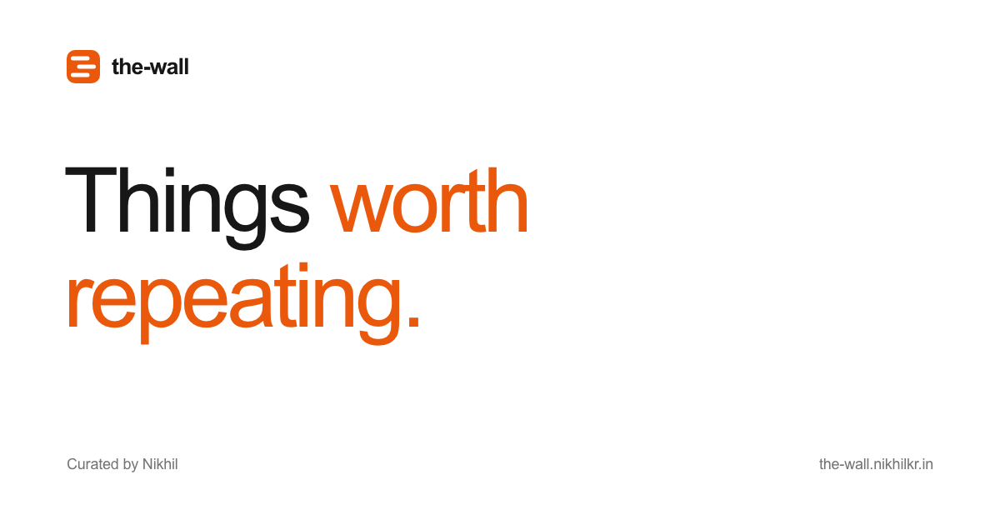

# The Wall

A personal collection of quotes I keep coming back to. Sometimes for a nudge,
sometimes just because they're good.

[Visit the wall](https://the-wall.nikhilkr.in) · [Subscribe via RSS](https://the-wall.nikhilkr.in/rss.xml)



Scroll through the moving strips, open a quote to read it, copy a line, or hit
**Surprise me**. Pause the wall whenever you like; it also respects reduced motion.

Built with **Next.js, React, TypeScript, Tailwind CSS, Base UI, and Motion**.

## Run locally

Use Node.js 22+ and npm.

```sh
npm ci
npm run dev
```

Open [localhost:4317](http://localhost:4317). To check and build the app:

```sh
npm run lint
npm run typecheck
npm run build
npm run start
```

## Add a quote

Edit [`quotes.json`](quotes.json), the only content file. Entries appear on the
wall in file order and in reverse order in the RSS feed. Append a new entry to
put it first in the feed. No CMS, submission backend, or code changes are needed.

Here is an existing entry in a compact form:

```json
{
  "id": "shaan-puri-modern-economy",
  "text": "The economy is just smart people paying beautiful people to promote stuff to insecure people.",
  "author": "Shaan Puri",
  "source": "Modern Wisdom #1163 · 00:00",
  "sourceUrl": "https://www.youtube.com/watch?v=XnQ2Da7HcRk&t=0s",
  "kind": "internet",
  "addedAt": "2026-11-07",
  "topics": [
    "work",
    "perspective",
    "humor"
  ]
}
```

Use a unique `id`. `kind` can be `famous` or `internet`. `sourceUrl`, `addedAt`,
and `topics` are optional; `addedAt` is the date you added the quote to the
collection, not the date it was originally said. Existing entries have additional
source and attribution details: preserve those when editing them.

## Sources and attribution

A quote's presence here does not certify its authorship. The optional
`attribution` field records a name, a status (`verified`, `unverified`, or
`disputed`), and notes about the evidence. `sourceDetails` records where a line
was found and who was heard speaking; `originalSource` can record an earlier
source. The speaker and the attributed author may be different people.

Keep exact wording when a record is labelled verbatim. Preserve uncertainty and
source evidence rather than filling gaps with guesses. The RSS feed includes
these notes alongside each quote.

Have a quote or correction? [Tell Nikhil on X](https://x.com/intent/post?text=%40nikhilkr_tw%20a%20quote%20for%20the-wall%3A%20), ideally with a source link or timestamp.

## Project layout

- `quotes.json` — quote collection.
- `src/app/` — page composition, layout, metadata, crawler routes, and RSS.
- `src/components/` — wall, strips, dialog, hero, and ticket-style footer.
- `src/lib/` — shared site metadata and analytics helpers.
- `public/` — static social image and icons.

The app is hosted on Vercel at **the-wall.nikhilkr.in**. Production deployments
use the `main` branch and `npm run build`.

## Optional analytics

Analytics uses PostHog. To configure your own instance, copy `.env.example` to
`.env.local` and set its public project token and API host. Analytics is limited
to production on `the-wall.nikhilkr.in`; local development and preview URLs do
not send events. The SDK loads only after a visitor allows analytics. Visitors
can withdraw that choice in the footer; Do Not Track and Global Privacy Control
keep analytics off. Analytics storage is scoped to this site. See `/privacy` for
details. Keep local environment files out of Git.

## License

The application code is available under the [MIT License](LICENSE). Quotation
text and the works it comes from belong to their respective rights holders and
are excluded from that license. Third-party assets retain their own licenses.
